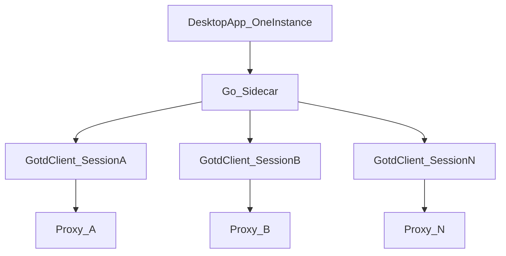
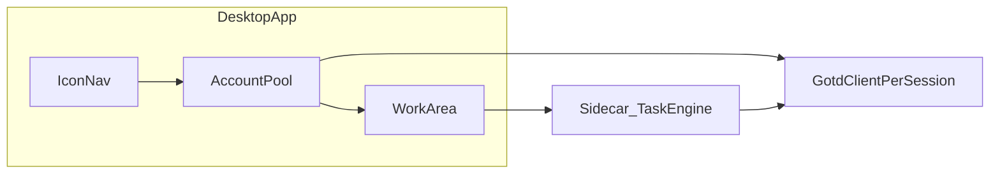

# 一期交互逻辑

- 依据文档：
  - `docs/Development-Plan.md`（v1.2）
  - `docs/Requirements-Closure-Analysis.md`（v1.2）
  - `docs/Telegram-Solutions-Feature-List.md`（v1.1）
- 整理日期：2026-10-08
- 文档版本：1.0
- 用途：锁定一期（MVP）信息架构、主交互流程、模块映射与状态反馈，供 UI 与前后端联调对照。
- 导航模型（已定）：**混合 — 微信三栏布局 + 任务流**
- UI 风格（已定）：**PC 端微信风格**（白底 + 绿色主交互）

---

## 1. 术语与账号模型

| 术语 | 含义 |
|---|---|
| 客户端 / 桌面应用 | 本软件安装后的 **一个** 桌面进程（Win / mac），即用户使用的「客户端」 |
| 协议号 | 导入的 Telegram **用户会话**（Session）；一个客户端下可管理 **N 个** 协议号 |
| gotd Client | sidecar 内与单个协议号绑定的 MTProto 连接实例 |
| 执行账号 | 用户在中栏勾选、用于跑当前任务的协议号集合 |
| 任务 | 一次可追踪的批量操作（含多目标、多协议号分发） |

### 1.1 模型纠正（重要）

- **不是**「一个协议号开一个桌面窗口 / 一个软件客户端」。  
- **是**：「**一个桌面客户端**」管理「**多个 TG 协议号**」。  
- 协议层约束：**一协议号 ↔ 一 gotd Client ↔ 一代理配置 ↔ 独立 `access_hash` 实体缓存**；禁止跨协议号复用实体凭据。

---

## 2. 整体信息架构（三栏）

| 栏 | 宽度倾向 | 内容 | 主要行为 |
|---|---|---|---|
| 左：图标导航 | 窄（约 56～64px） | 账号 / 消息 / 群组 / 联系人 / 采集 / 任务中心 / 设置 | 切换模块；选中态绿色图标或指示条 |
| 中：上下文列表 | 中（约 260～320px） | 默认 **协议号池**（可多选）；任务中心时切为任务列表；设置时切为设置分组 | 勾选执行账号；筛选；导入入口 |
| 右：工作区 | 自适应 | 模块表单 + 名单 + 主操作按钮 + 本任务实时日志 | 配置、提交任务、查看进度、导出 |

视觉约定（与开发计划 §1.4 一致）：

- 背景白 / 侧栏浅灰；主按钮与选中态绿色（建议 `--color-primary: #07C160`）。  
- 细线分割；少阴影、少卡片堆叠。  
- 一期无默认暗色主题。

---

## 3. 核心交互流程

### 3.1 首次进入（无协议号）

1. 启动客户端 → sidecar health 正常。  
2. 中栏为空，右栏展示空态引导：「导入 Session + JSON」。  
3. 用户选择文件 → 校验格式 → 成功写入协议号池；失败按类型提示（重复 / 失效 / 格式错误）。  
4. 引导完成后默认停留在 **账号** 模块。

### 3.2 日常主路径（任务流）

1. **选执行账号**：在中栏勾选 ≥1 个状态为「可用」的协议号；失效/冻结/代理失败等不可勾选，hover 或旁注说明原因。  
2. **选模块**：左栏进入消息 / 群组 / 联系人 / 采集等。  
3. **配置任务**：右栏填写目标名单、内容或动作参数；可选覆盖全局节奏（间隔/并发）。  
4. **提交**：前端校验 → 调用 sidecar 创建任务 → 主按钮进入进行中态；右栏下方展开本任务实时日志。  
5. **等待与失败**：FloodWait 显示「等待 Xs」且任务进入 `waiting`；隐私拒绝、权限不足等记入逐条结果，不整单静默失败。  
6. **结束**：成功/部分成功/失败汇总；支持导出；可跳转 **任务中心** 查看历史。

### 3.3 任务中心

1. 左栏进入「任务中心」。  
2. 中栏改为任务列表（按时间倒序；可按状态筛选）。  
3. 右栏为选中任务的详情：进度、协议号维度统计、逐条结果、取消（仅 `pending/running/waiting`）、导出。  
4. 取消后已发出的接口调用不回收；未执行条目标记 `cancelled`。

### 3.4 设置

1. 左栏进入「设置」。  
2. 中栏为设置分组：通用 / 默认节奏 / 代理模板 / 存储路径 / 关于。  
3. 右栏为对应表单；一期 **无注册登录**。  
4. 修改全局节奏后，仅影响之后新建任务；进行中任务不强制热更新（可在 UI 注明）。

---

## 4. 左栏模块与中/右栏映射（一期 MVP）

| 左栏模块 | 中栏 | 右栏 | 覆盖功能 |
|---|---|---|---|
| 账号 | 协议号列表（单选看详情；支持多选供他模块复用） | 详情：资料摘要、代理配置、F11 账号检查、F12 SpamBot、导入/移除 | 平台 + F11/F12 |
| 消息 | 协议号池（执行账号多选） | Tab：按用户名 / 手机号 / 用户 ID；名单、正文、提交、日志 | F01/F02/F03 |
| 群组 | 协议号池 | 动作切换：加入 / 退出 / 邀请联系人 / 按用户名加成员 | F06/F07/F08/F09 |
| 联系人 | 协议号池 | 动作：添加 / 删除；名单与结果表 | F19/F20 |
| 采集 | 协议号池 | 动作：成员采集 / 手机号检查；结果表 **必须显示来源字段** | F23/F25 |
| 任务中心 | 任务列表 | 任务详情与逐条结果 | 平台任务队列 |
| 设置 | 设置分组 | 表单 | 平台配置 |

### 4.1 跨模块账号勾选

- 中栏协议号勾选状态在「消息 / 群组 / 联系人 / 采集」之间 **保持**，切换模块不丢选。  
- 进入「账号 / 任务中心 / 设置」时，勾选状态内存保留，返回业务模块后恢复。  
- 若当前勾选协议号在任务运行中被标记为不可用，该号后续条目失败并写明原因，不自动改选其他号。

---

## 5. 状态与反馈

### 5.1 协议号状态（中栏展示）

| 状态 | UI 表现 | 可否勾选为执行账号 |
|---|---|---|
| 可用 | 绿色点或默认文案 | 是 |
| 检查中 | 灰色动画 | 否 |
| 等待（FloodWait 等） | 橙色 + 剩余时间 | 否（已在跑的任务内继续等待续跑） |
| 任务占用 | 标注当前任务名 | 可配置：默认允许加入新队列，或禁止并发（设置项，默认允许排队） |
| 代理失败 | 红色点 + 文案 | 否 |
| 失效（Auth） | 红色点 + 文案 | 否 |
| 冻结 | 红色点 + 文案 | 否 |

### 5.2 任务状态

`pending` → `running` → `waiting`（可选循环）→ `success` / `failed` / `cancelled`

### 5.3 结果分层（日志与导出字段）

每一条目标结果至少区分：

1. **本地执行**：是否已轮到、是否被取消  
2. **接口接受**：MTProto 调用是否返回成功  
3. **业务结果**：如需审批、隐私拒绝、未匹配等  
4. **未知**：超时或断线且无法确认  

禁止把「接口接受」直接展示为「已送达 / 已阅读」。

### 5.4 确认与危险操作

以下操作提交前必须二次确认（对话框，主按钮仍用绿色，文案明确后果）：

- 批量退出群/频道（F07）  
- 删除联系人（F20）  
- 移除协议号（本地删除会话文件）  

---

## 6. 典型页面交互细则

### 6.1 消息（F01/F02/F03）

1. 确认中栏已选执行账号。  
2. 右栏 Tab 切换定位方式；切换 Tab 不清空已填正文，但清空与该 Tab 绑定的名单解析缓存提示。  
3. F03：若协议号本地无 `access_hash`，该条结果记失败并提示「缺少实体缓存，请先通过用户名/对话等方式建立实体」，禁止静默借用其他协议号的 hash。  
4. F02/F25 共用结果枚举：匹配 / 未匹配 / 限制 / 失败 / 待重试；「未匹配」不得显示为「未注册」。

### 6.2 群组

- F06：目标支持用户名或邀请链接；结果区分成功 / 需审批 / 已在群 / 链接失效 / 加入上限。  
- F08/F09：无邀请权、对方隐私拒绝单独成错。  

### 6.3 采集（F23）

- 提交前选择来源模式：成员列表 / 消息发言者（可多选模式但导出时 **每行带来源**）。  
- 结果区表头固定含「来源」列；空隐私字段保持空，不补假数据。

### 6.4 空态与错误态

- 未选执行账号点「开始」：阻断并高亮中栏提示「请选择至少一个可用协议号」。  
- sidecar 断开：顶部非模态条提示「本地服务未连接」，业务按钮禁用。  
- 全局节奏文案旁注：「本地限速，非 Telegram 官方额度」。

---

## 7. 一期不做（交互层）

- 不为每个协议号打开独立桌面客户端窗口。  
- 无注册 / 登录 / 许可证购买入口（第三期）。  
- 无 F05 PostBot、F17 机器人限制处理及已砍扩展能力的菜单项。  
- 无统一私信中心（F22）、TDATA 导入（F18）、养号（F10/F13）、定时发布（F04）等二期入口（可预留禁用态，但一期默认不展示）。

---

## 8. 二期 / 三期预留（不展开实现）

| 期次 | 预留点 | 交互影响（摘要） |
|---|---|---|
| 二期 | 统一私信中心 F22 | 左栏可增「收件箱」；中栏会话列表；右栏聊天；路由仍按协议号隔离 |
| 二期 | 定时 / 活动 | 任务中心增加「计划」视图 |
| 三期 | 登录与许可证门禁 | 启动可插登录页；模块按权益锁定；断网降级策略另见商业化 PRD |

---

## 9. 与开发计划的衔接

| 工程阶段 | 本交互文档的用途 |
|---|---|
| P0 | 作为 UI/PRD 输入；与 UI 令牌一并评审 |
| P1 | 按三栏壳实现空态与导航 |
| P2 | 账号池 + 任务中心 + 日志分层 |
| P3 | 按 §4 映射实现各业务右栏 |
| P4 | 视觉与空态/危险确认回归 |

---

## 10. 修订记录

| 日期 | 版本 | 说明 |
|---|---|---|
| 2026-10-08 | 1.0 | 首次整理：混合三栏 + 任务流；明确一客户端多协议号、一协议号一 gotd Client |
